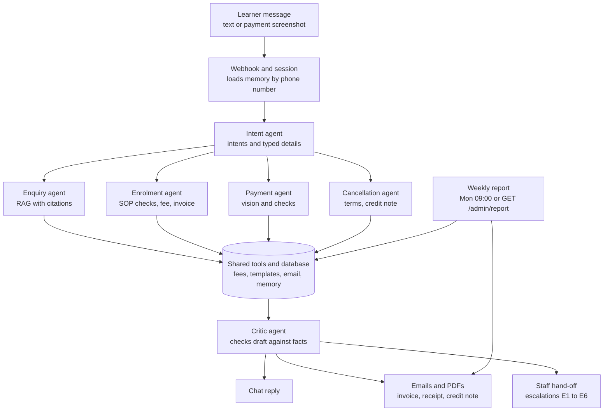

# Architecture (draft v0.4)

Proposed design for the ITI122 WhatsApp enrolment assistant. This is a draft: the split into four specialist agents is a team proposal, not a requirement of the guide. Redraw it to match the final build before submitting Q2.1.

Fixed by the guide: specialised agents with typed hand-offs, a critic that checks every draft reply, guardrails, a trace per message, escalation codes E1 to E6, and rules retrieved from the PDFs at run time (never hard-coded).

## Message flow

## Modules and their elements

| Build step | Module | Elements |
|---|---|---|
| Provided by kit | Chat page and simulator | Text and image in, replies out; email outbox view; localhost:8000; webhook receives each message |
| 1 | Database and memory | Leads, learners, enrolments, invoices, payments, cancellations, escalations, conversation history; keyed by phone number; `GET /admin/export` validated against `export_schema.json` |
| 1 | RAG over the PDFs | Reads `knowledge_base/` at run time; chunk, index, retrieve; cites the source of every fact; picks up a new PDF with no code change; no answer found raises E3 |
| 2 | Intent agent | Several intents per message; resolves references ("the first one", "my class"); typed extraction; mid-flow corrections; hands off to one specialist |
| 3 | Enrolment agent and tools | Collects SOP details; NRIC check letter and masked storage; age on first day; residency; prerequisite from Certificate Register; window, cut-off, seats; fee, funding and due date from documents; invoice from Excel template, emailed |
| 4 | Payment agent | Vision reads each screenshot (payee, amount, date, reference); checks against the invoice; result codes; updates records; receipt and confirmation; never sends reminders |
| 5 | Cancellation agent | Explains terms; waits for confirmation; before-first-day rule from documents; identity check (E4); credit note from template; emails learner, executive and Accounts |
| 6 | Weekly report | Monday 09:00 or `GET /admin/report`; Part A outstanding payments; Part B ongoing courses and seats; built from the database only; emailed to executive and Accounts |
| 7 | Critic, guardrails, trace | Critic checks every draft; never shows a full NRIC or another person's data; message and image text treated as data, not instructions; escalation routing E1 to E6; one trace file per message |

## Open design points

- Framework (LangGraph or CrewAI), LLM provider and embeddings choice: DEVLOG decisions D1 to D3.
- Where each agent's typed state lives and how hand-offs are validated (Pydantic models).
- Map each Q1.1 pain point to the components above when writing Q2.1.
